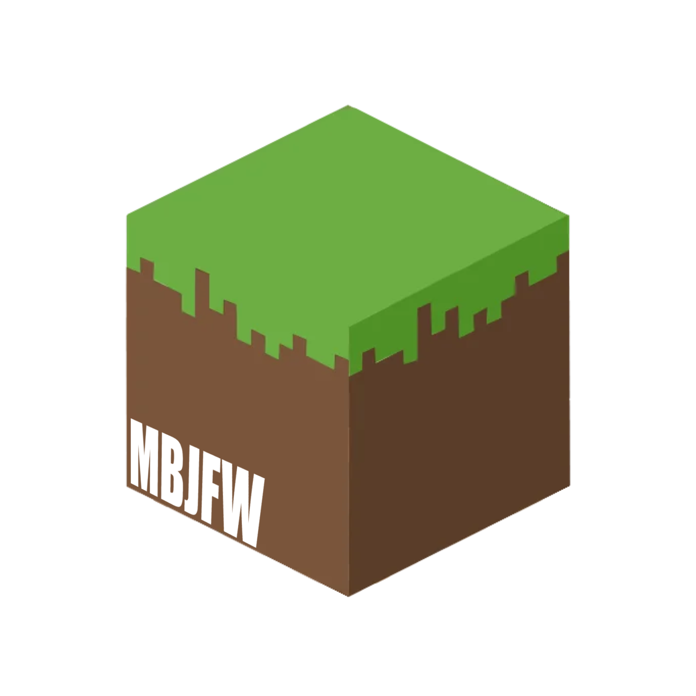

<table>
  <tr>
    <td valign="middle"></td>
    <td valign="middle"><h1>Minecraft Bedrock Just Fucking Works</h1></td>
  </tr>
</table>

A native macOS launcher and account manager for Minecraft Bedrock. It downloads and manages an Android Emulator matched to your Mac—ARM64 on Apple Silicon and x86_64 on Intel—runs it with the Mac GPU, sideloads your ARM64 APK, and starts Bedrock directly. Intel Macs use Android's ARM app translation support. You do not need Android Studio, a JDK, the upstream launcher UI, or a Google Play purchase for the game, if you already fucking own it.

Works with Minecraft Bedrock APK builds compatible with the bundled Android runtime; there are no per-version game hooks to keep chasing. Just drop a compatible APK here bro, I know you know how to get it.

## Why?

Because it's fucking crazy that nobody's done this. Bro. You have a pipeline creating shims to hack into the MCPE runtime and hook into every single function and make fake java replicates? DAWG. JUST USE AN EMULATOR. It's easier! This project aims to do exactly that. Let you run Minecraft Bedrock, using the ADK Emulator and your HOST GPU, not software rendering. Same performance, don't complain bro. Mojang, PLEASE add bedrock to mac. I did this only because I was too lazy to go upstairs to my PC, restart it, goto windows, and wait for 500 fucking shit ass spyware updates that sell my mouse movements and screenshot movements to microsoft data collectors and use it to train AI. Just let me fucking play bedrock on my mac bro.

And linux users, you guys have MCPE launcher. You wanna skimp out on buying the superior kernel, the mac, brokie? Haha. You're gonna have to wait until I port this to linux aswell, and keep using the shit mcpe-launcher buddy, sorry.

## Build and run

Requirements: macOS 15 or newer and Xcode command-line tools to build from source. First-run setup downloads Java, Android command-line tools, the emulator, and a host-matched Android image (several GB). MBJFW shows the Android SDK license and asks the user to accept before installing.

1. Build and open MBJFW:

   ```sh
   ./scripts/package-app.sh
   ```

2. Add your APK, select **Play now**, then accept the Android SDK terms in MBJFW. It downloads and sets up the runtime automatically.
3. Sign in to Microsoft/Xbox inside Bedrock. Add more MBJFW account profiles to keep each profile's Android data, sign-in, worlds, and settings separate.

Build the local installer with `./scripts/build-pkg.sh`. Pushing a version tag such as `v1.0.1` runs release builds on Apple Silicon and Intel, then attaches both app archives and installers with checksums to a draft GitHub release. See [Distribution and signing](docs/DISTRIBUTION.md).

APKs are copied locally into `~/Library/Application Support/MBJFW/apks/` and installed with `adb`. MBJFW does not contact Google Play, launch the Play Store, or apply an ownership/purchase check. It accepts one APK per import; split APK sets are not merged yet.

## What MBJFW adds

- Native SwiftUI Mac launcher, version library, and one-click play.
- Local APK import with no Play Store download flow.
- Checks GitHub for a newer published release on launch and asks before downloading the host-specific installer.
- Multiple local account profiles with isolated Microsoft sign-ins, worlds, and settings. Authentication happens in-game; MBJFW never collects Microsoft passwords or tokens.
- Host-matched Android virtual device accelerated by the Mac GPU (`-gpu host`, which can use MoltenVK on macOS); Intel guests translate the ARM64 Minecraft app.
- No Play Store image and no Google account sign-in required by MBJFW.

## Compatibility

MBJFW uses an Android 15 Google APIs image without the Play Store: ARM64 on Apple Silicon and x86_64 with ARM64 app translation on Intel Macs. Compatibility still depends on Android's translation support, the APK's ABI and Android version requirements, Minecraft's own sign-in/license behavior, and emulator graphics support. Intel gameplay performance depends on the translated guest workload and has not been measured against Apple Silicon.

## Development

```sh
swift build
swift run MBJFW
```

See [`docs/DEVELOPMENT.md`](docs/DEVELOPMENT.md) if you wanna get familiar with this god awful amalgamation of a project that spans many languages. Peek, if you dare..

## More docs

- [Runtime architecture](docs/ARCHITECTURE.md)
- [Native bridge API](docs/API.md)
- [Building, packaging, and signing](docs/DISTRIBUTION.md)
- [Runtime downloads and privacy](docs/PRIVACY.md)
- [Third-party notices](THIRD_PARTY_NOTICES.md)
